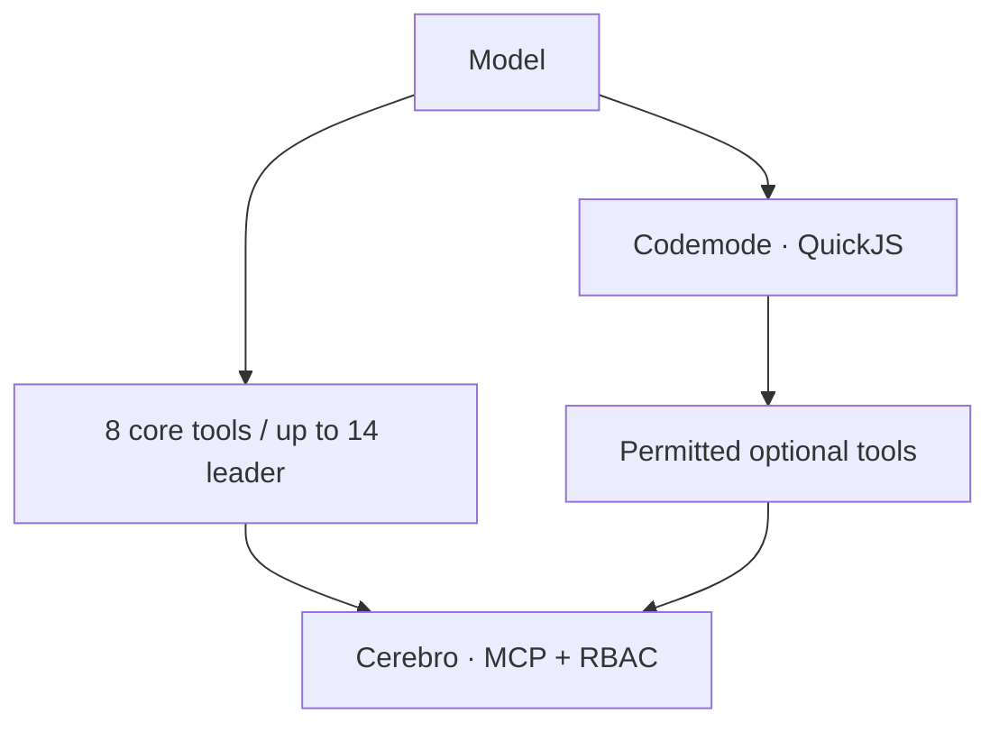

# AMA · Agent Memory Access

## From classic MCP to code against a typed API

The classic way to give a model tools is to load **every tool definition** into its context and let it call them one at a time. With a small catalog that is fine. With a shared memory, a task board, a document vault and a correspondence system — dozens of tools — the definitions are paid for in every request, before any useful work, and every intermediate result flows back through the model.

A newer pattern, popularised by Cloudflare's [Code Mode](https://blog.cloudflare.com/code-mode/) and explored in Anthropic's [code execution with MCP](https://www.anthropic.com/engineering/code-execution-with-mcp), changes the interface: models are good at **writing code**, so the agent gets a small, stable set of direct tools plus a sandbox where it writes a short program against a typed API of the rest. Definitions are looked up when needed; intermediate data stays in the program; only the result returns to the model.

**AMA (Agent Memory Access) is that pattern applied to Cerebro, inside Pi.** It is a Pi-side adapter for an existing Cerebro MCP service, not a competing wire protocol. MCP itself does not mandate full exposure — clients can filter, discover or cache — AMA is a concrete, governed way to do it for a team of agents.

AMA keeps a small stable direct core and exposes the authorized remainder to **codemode** (a QuickJS sandbox). Tools are still registered and governed by launch allowlists, own-agent keys and server RBAC. A catalog is not authorization; selecting the leader profile does not grant administrative rights.



## Two profiles

| Profile | Direct Cerebro surface | Limits |
| --- | --- | --- |
| `subagente` | 8 everyday tools. | Administrative routes excluded; role restrictions still apply. |
| `lider` | Same 8 + up to 6 frequent coordination tools = 14 maximum. | Only registered/allowlisted tools; no new rights. |

Core: `cb_whoami`, `cb_correspondencia_resumen`, `cb_task_get`, `cb_task_comment`, `cb_task_submit`, `cb_vault_read`, `cb_memory_add`, `cb_memory_search`.

Leader extras: `cb_task_activity`, `cb_correspondencia_leer`, `cb_task_create`, `cb_correspondencia_ok`, `cb_task_update`, `cb_task_review`.

Profile selection was based on a census of real completed tool calls from the leader offices, counting direct and nested results, including failures. It supports **profile design**, not a savings claim or an inference of permissions.

## Quickstart: compatible existing Cerebro deployment

Prerequisites: a trusted Pi runtime with exposure/codemode support (validated against 1.4.0), a validated version-2 team config, own-agent credentials and an existing compatible service.

```sh
pi install npm:@otixe/pi-cerebro-ama@0.1.0
```

1. Back up bridge/activator/settings. Disable duplicate `cerebro-mcp.ts` and herramientas activators: AMA replaces those entry points; do not co-load `@otixe/pi-herramientas` as a second activator.
2. Configure `PI_OFICINAS_EQUIPO` and `CEREBRO_MCP_URL` for your deployment without committing credentials. Adapt the package's [configuration examples](https://github.com/otixe/pi-oficinas/tree/main/packages/pi-cerebro-ama/examples).
3. Create a valid `.pi/herramientas.json` catalog, preserving non-memory groups and role permissions.
4. Create `.pi/cerebro-surface.json`:

```json
{"mode":"ama","perfil":"subagente"}
```

Use `"perfil":"lider"` only for a provisioned leader. Omission defaults to `subagente`.

5. Start a **new process**, not just `/new`. Verify `cb_whoami`, the AMA surface/profile, active tools and server attribution. Missing/invalid flags or catalog keep traditional mode; absent codemode means shrinking is not accepted.
6. For an authorized optional operation:

```js
const result = await tools.cb_task_activity({ task_id: "your-task-id" });
text(result);
```

QuickJS has no direct Node/filesystem/network access, but invoked tools retain their effects. Print only needed output. A smaller surface is neither a sandbox for those effects nor a smaller permission set.

## Efficiency: the principle, and what is not claimed yet

AMA is designed to be more efficient than full-exposure MCP in three ways:

1. **Smaller fixed context.** The model sees a handful of definitions instead of the whole catalog, in every request.
2. **Less round-trip traffic.** A multi-step operation — read a task, search memory, write a comment — can be one short program instead of several model turns with intermediate results in context.
3. **Progressive disclosure.** The long tail is reached on demand, only for the agents and roles that are permitted to use it.

**This manual deliberately publishes no savings figures.** Internal runs exist, but the quantified results will be added after a measurement that is representative and reproducible. Until then, treat efficiency as a design property to verify on your own workload with the tool below, not as a promised percentage. The size of any benefit depends on catalog size, model, provider caching and workload.

### The cache rule

Provider prompt caching rewards a **stable prefix**. Changing the set of direct tools midway through a session changes that prefix and can invalidate the cache — which can cost more than the definitions saved. So: keep the direct tool set stable, prefer codemode for anything optional, use an activator only when necessary and record why. Fewer input tokens is also not automatically less money: cached reads, cache writes and uncached input are priced differently.

## Measure your own workload and roll back

Python 3.10+, local authorized JSONL files, explicit bounded manifest globs:

```sh
python3 packages/pi-cerebro-ama/bin/measure-jsonl.py measurement.json --output comparison.json
```

Use the public package's [manifest example](https://github.com/otixe/pi-oficinas/blob/main/packages/pi-cerebro-ama/examples/measurement.json), with your own paths kept private. Confirm new-process exposure; label old-process resumes and `/new` explicitly. Separate deployment transitions, profiles, provider/model and high-cache-write partitions, and do not compare workloads or profiles as if they were controlled.

To restore traditional exposure, remove `.pi/cerebro-surface.json` and open a new process. For integration rollback also restore saved bridge/activator/settings. Removing the flag does not undo catalogs or launch allowlists. See [source status](sources.md).
