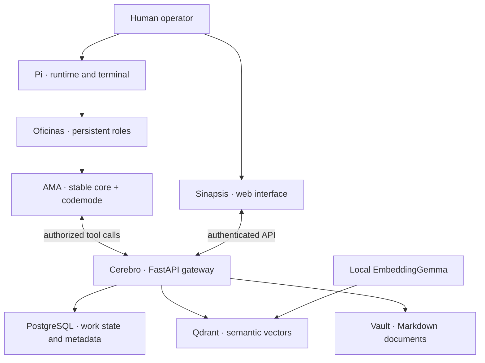

# Architecture

The four components are different responsibilities, not four interchangeable agent frameworks. **AMA is an access strategy on the Pi–Cerebro edge**, not another database or a replacement for MCP transport.

## One task across the system

1. A person or authorized coordinator defines a task and its acceptance criteria in Cerebro.
2. A persistent office reads and claims it; the server records ownership.
3. Pi executes authorized tools. AMA keeps common calls direct and routes optional calls through codemode.
4. The office retrieves relevant memory and documents, performs the scoped work, and records evidence and rollback.
5. An independent reviewer checks the deliverable; a gate accepts or returns it. People inspect the same work state through Sinapsis.
6. Checkpoints and durable notes preserve continuity when the session ends. A new session verifies current state rather than blindly trusting a summary.

## Inside the shared-state boundary

| Technology | Responsibility | Not responsible for |
| --- | --- | --- |
| FastAPI gateway | Authenticated operations, validation and service orchestration. | Granting permission because a tool is visible. |
| PostgreSQL | Durable task/identity/permission metadata and relational state. | Replacing semantic similarity search. |
| Qdrant | Vector retrieval for semantically related knowledge. | Being the only authoritative work-state store. |
| EmbeddingGemma | Local text-to-vector embeddings for retrieval. | Eliminating external model calls by Pi. |
| Hybrid search | Combine semantic retrieval with lexical/BM25 matches. | Proving a retrieved statement is current or correct. |
| Markdown vault | Human-readable documents and durable source material. | Automatically becoming public or safe to export. |
| React/Vite + FastAPI | Reported Sinapsis frontend/backend stack. | An independently reproduced public deployment. |

The model provider is outside the diagram's shared-state boundary. Local embeddings do **not** imply that all agent inference or tool results stay local. Data policy must account for provider requests, retained logs, extensions and backups.

## Trust boundaries

Pi extensions run in-process with the user's OS permissions. QuickJS restricts codemode's direct runtime APIs, but tool calls can still reach files, networks and services. Server RBAC and launch allowlists remain authoritative; neither a catalog nor a smaller tool surface grants or removes access by itself.

Continue with [Pi](pi.md), [Cerebro](cerebro.md) and the [operating method](workflow.md).
