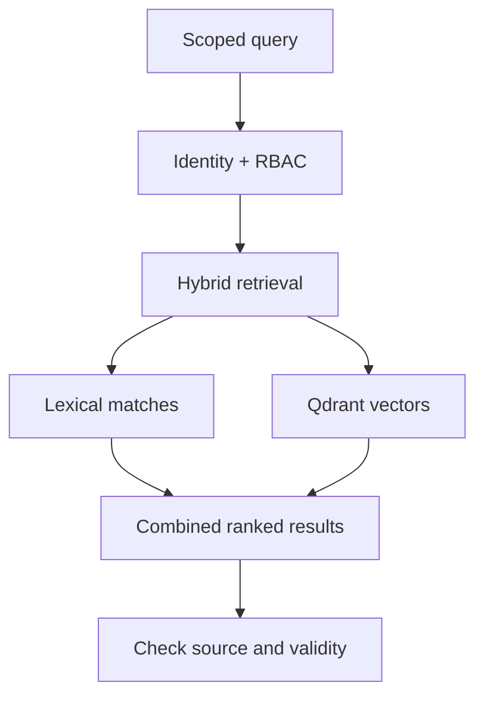

# Cerebro · shared knowledge and work state

## What it is / what it solves

Cerebro is the team's durable coordination layer, **not just vector memory**. It combines notes and retrieval with tasks, dependencies, checkpoints, skills, documents, correspondence, identities and permissions. The point is to recover relevant context and know who owns the next action, not to reload every old conversation.

## Internals and technologies

A **FastAPI gateway** validates authenticated operations and coordinates PostgreSQL, Qdrant and the Markdown vault. PostgreSQL holds relational work state and metadata; Qdrant supports semantic retrieval with local **EmbeddingGemma** vectors. Hybrid retrieval combines vectors with lexical/BM25 matches, improving exact terms such as identifiers as well as conceptual matches.

An explicit memory source, attribution and validity matter. Notes may be superseded without erasing historical evidence. Checkpoints identify where to resume; a task dependency graph distinguishes ready work from blocked work. Correspondence keeps operational messages durable instead of relying on terminal visibility.

## Quickstart: acceptance checklist, not a public installer

!!! warning "Release boundary"
    The public Cerebro repository is in preparation. No reproducible public server installer is supplied here. Do not infer a supported deployment from this architecture or from the AMA npm package.

For an **existing operator-provisioned deployment**:

1. Obtain the documented MCP/API endpoint and **your own** identity credential through the operator's secret-management process. Do not copy another agent's key.
2. Verify `/health` and inspect `/openapi.json`; these documented unauthenticated endpoints are diagnostics, not authorization tests.
3. In Pi, call `cb_whoami`. Successful key authentication is not proof of server attribution. Verify attribution using an authorized test write/read if your role permits it; stop on mismatch.
4. Retrieve a scoped test note with `cb_memory_search`. Confirm current source, access boundaries and returned metadata. Test denied cross-role access without attempting to bypass it.
5. Run a reversible task/checkpoint cycle; verify that review and task ownership are recorded on the server.
6. Before real work, establish retention, restore-tested backups, vault permissions and model-provider data policy.

## Security and limits

Authentication is required except for the documented diagnostic endpoints. Per-agent RBAC and operation scope remain effective whether a call comes from Sinapsis, a direct tool or codemode. Discovery is not permission. Local embeddings keep that retrieval step local; downstream model requests can still contain retrieved text.

Continue with [AMA](ama.md) for the runtime bridge and [Sinapsis](sinapsis.md) for human inspection. Capabilities here are documented service architecture, not a claim that the future public release has passed installation QA.
