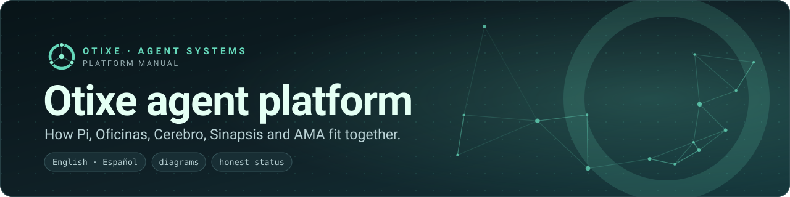
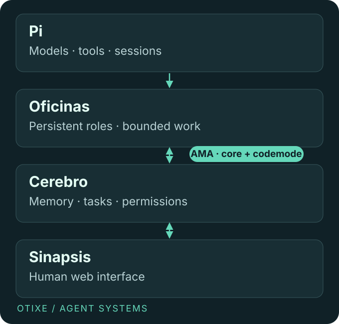

# Persistent agents. Shared memory. Human control.

**A coordinated team, not a pile of chat windows.** Pi runs the agents. Oficinas gives them persistent roles. Cerebro keeps the shared knowledge and work state. Sinapsis makes that state visible to people. AMA shrinks the tool-definition surface between the runtime and Cerebro.

## The problem

A single agent has a finite context window. Long tasks accumulate repeated explanations, lost decisions and expensive tool definitions. Adding more agents does not fix this by itself: without ownership and review, they duplicate work or approve their own mistakes.

## The solution

Separate **execution**, **team structure**, **shared state** and **human control**. Give each role only the permissions it needs, preserve decisions outside transient context, and require proportionate evidence before a change is accepted.

| Layer | What it contributes | Start here |
| --- | --- | --- |
| Pi | Models, tools, sessions, terminal and extension lifecycle. | [Runtime](pi.md) |
| Oficinas | Persistent specialists, bounded delegation and task ownership. | [Teams](oficinas.md) |
| Cerebro | Memory, tasks, documents, skills, correspondence and permissions. | [Shared state](cerebro.md) |
| Sinapsis | Human web access to the same operational state. | [Web interface](sinapsis.md) |
| AMA | Small stable direct tool profiles plus codemode access. | [Integration, design and cache rule](ama.md) |

## What is available today

The [extension monorepo](https://github.com/otixe/pi-oficinas) and six `@otixe` npm packages at `0.1.0` are public. Pi has an [Otixe fork](https://github.com/otixe/pi) and an [upstream project](https://github.com/earendil-works/pi). Cerebro's public repository and Sinapsis's public release are in preparation. This manual is an unpublished handoff, not proof of an active hosted service.

Start with [architecture](architecture.md), then a [component quickstart](pi.md). For evaluation, read the [working method](workflow.md) and [AMA chapter](ama.md) before assuming any saving or granting access.

!!! note "Scope, not a guarantee"
    This is a documented operating design and a set of published extensions, not a claim of certification, an enterprise SLA, fully autonomous execution or universal cost reduction. The [source ledger](sources.md) distinguishes verified facts, reported results and planned releases.
