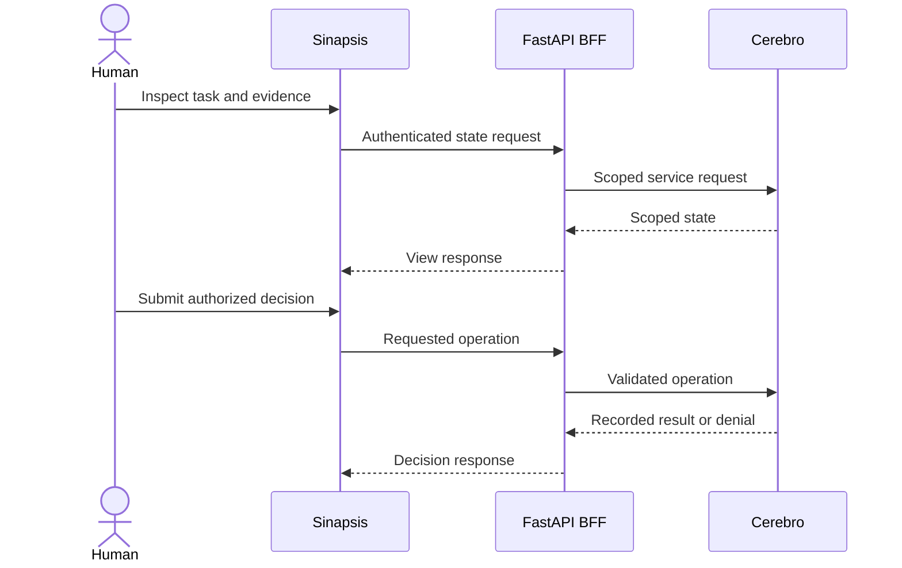

# Sinapsis · the human web surface

## What it is / what it solves

Sinapsis is the human interface over Cerebro: a web counterpart to operational terminal access. It helps people inspect shared work, coordinate and make decisions without relying on an agent's current conversation or a particular open pane. It is **not** a second memory store or an alternative authorization authority.

## Internals and technologies

The reported stack is **React + Vite** for the frontend and a **FastAPI BFF (backend for frontend)** that acts as a Cerebro client. These details come from internal design/runbook documentation, not a public build reproduced for this manual. The project coordinator confirmed this architecture and that publication is in preparation. The UI presents Cerebro state; actions must be validated by the service and scoped to the authenticated actor.

Read visibility and decision authority are different. A screen may show a task without allowing that user to approve it. A message acknowledgement is not an approval; a UI notification is not durable task ownership.

## Quickstart: operator checklist

!!! warning "Public source pending"
    No public Sinapsis repository or reproducible install command is confirmed for this handoff. This is a conceptual integration and acceptance checklist, not a runnable `git clone` tutorial. Public source and deployment steps remain a release prerequisite.

On an operator-provisioned instance:

1. Sign in with your own approved human identity; never expose an agent or administrative service key to frontend bundles.
2. Confirm the selected environment and role before making changes.
3. Open a reversible test task and compare its current state with the same task retrieved from Cerebro in Pi.
4. Check a permitted operation, an expected denial and stale-state handling. The backend must reject unauthorized actions even when client controls are manipulated.
5. Inspect evidence, actor attribution and the recorded decision after a refresh.
6. Establish access revocation, HTTPS policy, audit retention, backup/restore and frontend secret scanning before deployment.

## Acceptance and limits

This manual does not claim UI feature completeness, screenshots of a public product or an independently tested Sinapsis deployment. The sequence above describes the intended data/control contract. See [sources and status](sources.md) for reported versus verified information, and the [working method](workflow.md) for decision gates.
