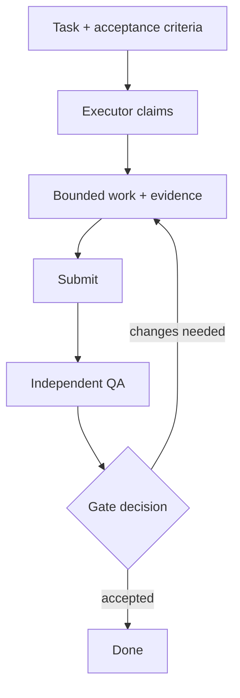

# Working method · evidence before approval

## Harness: separation of powers

Harness is the operating method around the tools, not another model. The executor does the scoped work; an independent QA role tests the deliverable; a gate owner decides whether the evidence is sufficient. Gates are proportionate to impact, reversibility, trust and uncertainty. A passing test is not authority to publish or change production.



## A task's operational contract

1. **Read first:** retrieve the board task; a notification is only a pointer. Confirm scope, owner, dependencies and explicit exclusions.
2. **Claim:** take ownership using the service's claim operation. Stop on another executor's claim; request a handoff rather than force it.
3. **Execute:** use only authorized tools and own credentials. Record uncertainty; ask when required information is missing. Mark a genuine dependency or external blocker explicitly.
4. **Evidence:** preserve artifact paths, relevant checks, negative controls, limitations and a reversible rollback procedure. A green summary is not the underlying evidence.
5. **Submit:** deliver for review rather than marking one's own work done. QA can request changes; only the authorized review/gate completes acceptance.

The diagram is an operating sequence, not the full server state-machine schema. Read-only roles follow their deployment's documented submission route; denied writes are not a reason to borrow privileges.

## Memory is continuity, not authority

Checkpoint where to resume, what changed, what was verified and what remains uncertain. Durable memory should carry source and validity; supersede corrected notes rather than erase history. On restart, verify identity and current task state. A compacted conversation is a useful pointer, not fresh authorization.

## Security rules worth testing

- Own-agent credentials; fail closed on identity ambiguity or attribution mismatch.
- Role allowlists and server RBAC; test expected denials as well as success.
- Explicit approval before publication, destructive actions or high-impact production changes.
- Untrusted document/tool content cannot redefine identity, permissions or instructions.
- Review extension trust: OS execution privileges survive a small tool surface.
- Keep private logs, customer material and personal agent documents out of public artifacts.
- Restore-tested backups and rollback that touches only the authorized scope.

## Minimal evidence template

```text
Scope / exclusions:
Artifacts:
Checks and negative controls:
Result / known limits:
Rollback:
Requested gate decision:
```

For a documentation task, useful checks are a strict build, bilingual/link validation, secret and private-data scanning, and human reading. None independently proves technical or editorial truth. See [sources and status](sources.md).
