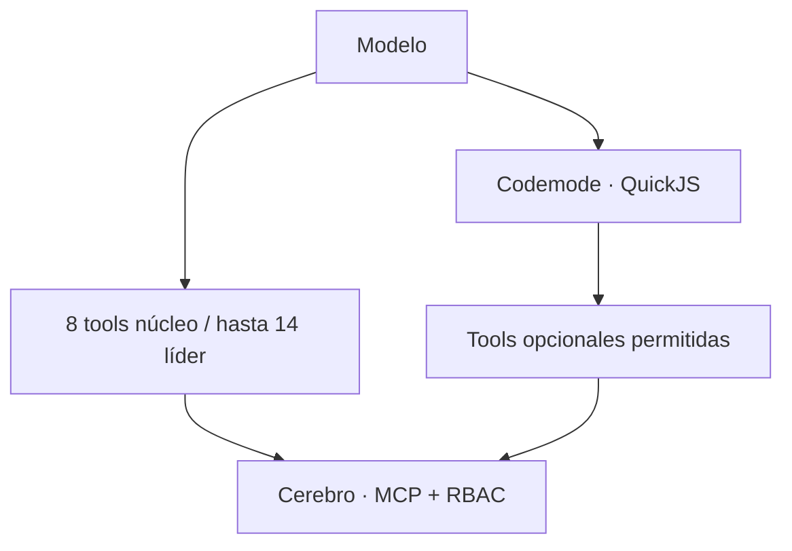

# AMA · Agent Memory Access

## Del MCP clásico al código contra una API tipada

La forma clásica de dar tools a un modelo es cargar en su contexto **la definición de cada tool** y dejar que las llame una por una. Con un catálogo chico funciona. Con una memoria compartida, un tablero de tareas, un vault de documentos y un sistema de correspondencia —decenas de tools— las definiciones se pagan en cada request, antes de hacer trabajo útil, y cada resultado intermedio vuelve a pasar por el modelo.

Un patrón más nuevo, difundido por el [Code Mode](https://blog.cloudflare.com/code-mode/) de Cloudflare y explorado por Anthropic en [code execution with MCP](https://www.anthropic.com/engineering/code-execution-with-mcp), cambia la interfaz: los modelos son buenos **escribiendo código**, así que el agente recibe un conjunto pequeño y estable de tools directas y un sandbox donde escribe un programa corto contra una API tipada del resto. Las definiciones se consultan cuando hacen falta; los datos intermedios quedan en el programa; al modelo sólo vuelve el resultado.

**AMA (Agent Memory Access) es ese patrón aplicado a Cerebro, dentro de Pi.** Es un adaptador del lado Pi para un servicio Cerebro MCP existente, no otro protocolo de transporte. MCP no obliga a la exposición completa —los clientes pueden filtrar, descubrir o cachear—; AMA es una forma concreta y gobernada de hacerlo para un equipo de agentes.

AMA conserva un núcleo directo pequeño y estable y expone el resto autorizado a **codemode** (sandbox QuickJS). Las tools siguen registradas y sujetas a allowlists de lanzamiento, keys propias y RBAC del servidor. Un catálogo no autoriza; elegir el perfil líder no concede administración.



## Dos perfiles

| Perfil | Superficie Cerebro directa | Límites |
| --- | --- | --- |
| `subagente` | 8 tools cotidianas. | Rutas administrativas excluidas; restricciones de rol siguen vigentes. |
| `lider` | Las mismas 8 + hasta 6 de coordinación = máximo 14. | Sólo registradas/allowlisted; sin derechos nuevos. |

Núcleo: `cb_whoami`, `cb_correspondencia_resumen`, `cb_task_get`, `cb_task_comment`, `cb_task_submit`, `cb_vault_read`, `cb_memory_add`, `cb_memory_search`.

Extras líder: `cb_task_activity`, `cb_correspondencia_leer`, `cb_task_create`, `cb_correspondencia_ok`, `cb_task_update`, `cb_task_review`.

La selección se basó en un censo de llamadas completadas reales de las oficinas líder, contando resultados directos y anidados, incluso fallidos. Sirve para **diseñar el perfil**, no para afirmar ahorro ni inferir permisos.

## Quickstart: Cerebro compatible ya existente

Requisitos: Pi confiable con exposición/codemode compatibles —validado contra 1.4.0—, equipo versión 2 validado, credenciales propias y servicio compatible existente.

```sh
pi install npm:@otixe/pi-cerebro-ama@0.1.0
```

1. Respaldá bridge/activador/settings. Deshabilitá `cerebro-mcp.ts` y activadores duplicados: AMA reemplaza esos entry points; no cargues `@otixe/pi-herramientas` como segundo activador.
2. Configurá `PI_OFICINAS_EQUIPO` y `CEREBRO_MCP_URL` para tu despliegue sin commitear credenciales. Adaptá los [ejemplos del paquete](https://github.com/otixe/pi-oficinas/tree/main/packages/pi-cerebro-ama/examples).
3. Creá un catálogo `.pi/herramientas.json` válido, preservando grupos no-memoria y permisos por rol.
4. Creá `.pi/cerebro-surface.json`:

```json
{"mode":"ama","perfil":"subagente"}
```

Usá `"perfil":"lider"` sólo para un líder provisionado. Omitirlo selecciona `subagente`.

5. Abrí un **proceso nuevo**, no sólo `/new`. Verificá `cb_whoami`, superficie/perfil AMA, tools activas y atribución en servidor. Flag o catálogo ausente/inválido mantiene modo tradicional; sin codemode no se acepta reducción.
6. Para una operación opcional autorizada:

```js
const result = await tools.cb_task_activity({ task_id: "your-task-id" });
text(result);
```

QuickJS no accede directamente a Node/filesystem/red, pero las tools invocadas conservan sus efectos. Emití sólo lo necesario. Una superficie menor no es sandbox de esos efectos ni un conjunto menor de permisos.

## Eficiencia: el principio, y lo que todavía no se afirma

AMA está diseñado para ser más eficiente que el MCP de exposición completa de tres maneras:

1. **Contexto fijo menor.** El modelo ve un puñado de definiciones en vez de todo el catálogo, en cada request.
2. **Menos viajes.** Una operación de varios pasos —leer una tarea, buscar en memoria, escribir un comentario— puede ser un programa corto en vez de varios turnos del modelo con resultados intermedios en contexto.
3. **Divulgación progresiva.** La cola larga se alcanza a demanda, sólo para los agentes y roles autorizados.

**Este manual no publica cifras de ahorro, a propósito.** Hay corridas internas, pero los resultados cuantificados se agregarán después de una medición representativa y reproducible. Mientras tanto, la eficiencia es una propiedad de diseño que verificás en tu propia carga con la herramienta de abajo, no un porcentaje prometido. El tamaño de cualquier beneficio depende del tamaño del catálogo, el modelo, la caché del proveedor y la carga.

### La regla de la caché

La caché de prompt del proveedor premia un **prefijo estable**. Cambiar el conjunto de tools directas a mitad de sesión cambia ese prefijo y puede invalidar la caché, lo que puede costar más de lo que ahorraban las definiciones. Por eso: mantené estable el conjunto directo, preferí codemode para lo opcional, usá un activador sólo si hace falta y registrá el motivo. Además, menos tokens de entrada no es automáticamente menos dinero: lecturas cacheadas, escrituras de caché e input no cacheado tienen precios distintos.

## Medí tu carga y revertí

Python 3.10+, JSONL locales autorizados, globs de manifest explícitos y acotados:

```sh
python3 packages/pi-cerebro-ama/bin/measure-jsonl.py measurement.json --output comparison.json
```

Usá el [manifest de ejemplo público](https://github.com/otixe/pi-oficinas/blob/main/packages/pi-cerebro-ama/examples/measurement.json), conservando privadas tus rutas. Confirmá exposición en proceso nuevo; etiquetá explícitamente resumes de proceso viejo y `/new`. Separá transición de despliegue, perfiles, proveedor/modelo y particiones de cacheWrite alto, y no compares cargas o perfiles como si fueran controlados.

Para volver a exposición tradicional, eliminá `.pi/cerebro-surface.json` y abrí un proceso nuevo. Para rollback de integración, restaurá bridge/activador/settings guardados. Quitar el flag no revierte catálogos ni allowlists de lanzamiento. Consultá [estado de fuentes](sources.md).
