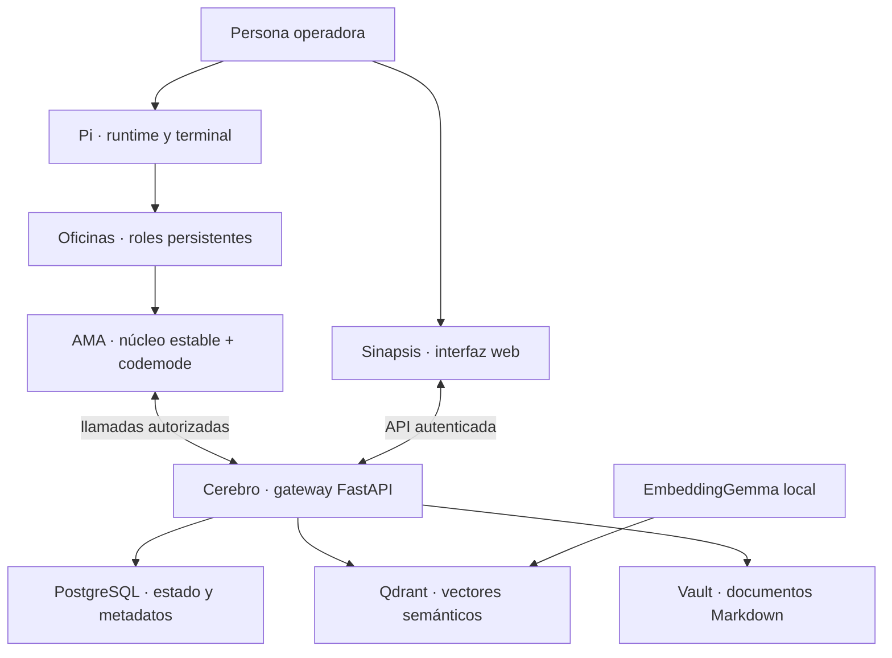

# Arquitectura

Los cuatro componentes tienen responsabilidades distintas; no son cuatro frameworks intercambiables. **AMA es una estrategia de acceso en el enlace Pi–Cerebro**, no otra base de datos ni un reemplazo del transporte MCP.

## Una tarea a través del sistema

1. Una persona o coordinador autorizado define la tarea y sus criterios de aceptación en Cerebro.
2. Una oficina persistente la lee y toma; el servidor registra al responsable.
3. Pi ejecuta tools autorizadas. AMA mantiene directas las llamadas comunes y deriva las opcionales a codemode.
4. La oficina recupera memoria y documentos relevantes, ejecuta el alcance acordado y registra evidencia y rollback.
5. Un revisor independiente comprueba la entrega; un gate acepta o devuelve. Las personas consultan ese mismo estado desde Sinapsis.
6. Checkpoints y notas duraderas preservan continuidad cuando termina la sesión. Una nueva sesión verifica el estado actual en lugar de confiar ciegamente en un resumen.

## Dentro del límite de estado compartido

| Tecnología | Responsabilidad | No le corresponde |
| --- | --- | --- |
| Gateway FastAPI | Operaciones autenticadas, validación y orquestación. | Conceder permisos porque una tool sea visible. |
| PostgreSQL | Metadatos duraderos de tareas/identidad/permisos y estado relacional. | Sustituir búsqueda por similitud semántica. |
| Qdrant | Recuperación vectorial de conocimiento relacionado. | Ser la única fuente autoritativa del estado de trabajo. |
| EmbeddingGemma | Embeddings locales de texto para recuperación. | Eliminar llamadas de Pi a modelos externos. |
| Búsqueda híbrida | Combinar recuperación semántica con coincidencias léxicas/BM25. | Demostrar que un resultado es vigente o correcto. |
| Vault Markdown | Documentos legibles y fuentes duraderas. | Volverse público o seguro de exportar automáticamente. |
| React/Vite + FastAPI | Stack frontend/backend reportado de Sinapsis. | Un despliegue público reproducido independientemente. |

El proveedor de modelos está fuera del límite de estado compartido del diagrama. Embeddings locales **no** implica que toda inferencia o resultado de tool permanezca local. La política de datos debe considerar requests al proveedor, logs, extensiones y backups.

## Límites de confianza

Las extensiones Pi se ejecutan con los permisos de sistema del proceso. QuickJS restringe las APIs directas de codemode, pero las tools todavía pueden acceder a archivos, redes y servicios. RBAC del servidor y allowlists de lanzamiento siguen siendo autoritativos: ni un catálogo ni una superficie menor conceden o quitan permisos por sí solos.

Continuá con [Pi](pi.md), [Cerebro](cerebro.md) y el [método operativo](workflow.md).
