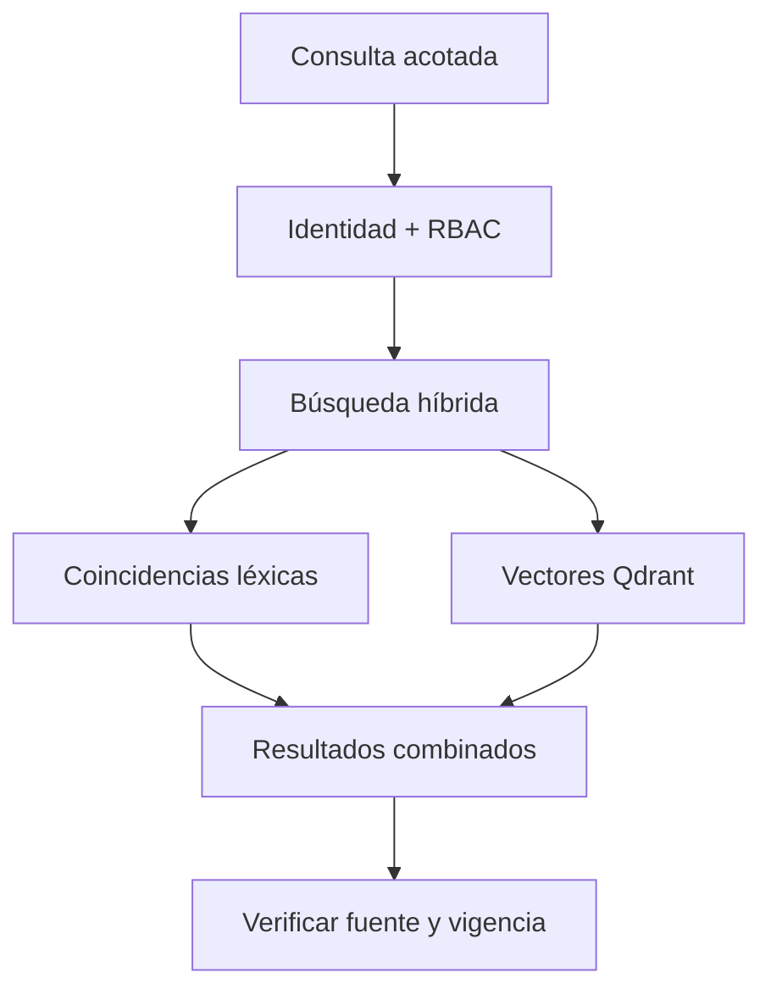

# Cerebro · conocimiento y estado de trabajo compartidos

## Qué es / qué resuelve

Cerebro es la capa duradera de coordinación del equipo, **no sólo memoria vectorial**. Combina notas y recuperación con tareas, dependencias, checkpoints, skills, documentos, correspondencia, identidades y permisos. El objetivo es recuperar contexto relevante y saber quién tiene la próxima acción, no volver a cargar todas las conversaciones.

## Internos y tecnologías

Un **gateway FastAPI** valida operaciones autenticadas y coordina PostgreSQL, Qdrant y el vault Markdown. PostgreSQL guarda estado relacional y metadatos; Qdrant sostiene recuperación semántica con vectores locales de **EmbeddingGemma**. La búsqueda híbrida combina vectores con coincidencias léxicas/BM25: sirve tanto para términos exactos, como identificadores, como para relaciones conceptuales.

Importan fuente explícita, atribución y vigencia. Una nota puede ser reemplazada sin borrar evidencia histórica. Checkpoints señalan dónde retomar; dependencias de tareas separan trabajo listo del bloqueado. La correspondencia conserva mensajes operativos sin depender de que alguien vea una terminal.

## Quickstart: checklist de aceptación, no instalador público

!!! warning "Límite de publicación"
    El repo público de Cerebro está en preparación. Aquí no se ofrece un instalador público reproducible del servidor. La arquitectura y el paquete npm AMA no prueban un despliegue soportado.

Para un **despliegue existente provisionado por su operador**:

1. Obtené endpoint MCP/API documentado y credencial de **tu propia** identidad mediante la gestión de secretos del operador. No copies la key de otro agente.
2. Verificá `/health` e inspeccioná `/openapi.json`: estos endpoints documentados sin autenticación son diagnóstico, no prueba de autorización.
3. Llamá `cb_whoami` desde Pi. Que una key autentique no prueba su atribución en servidor. Verificá atribución mediante escritura/lectura de prueba autorizada si tu rol permite; frená ante un desacuerdo.
4. Recuperá una nota de prueba acotada con `cb_memory_search`. Confirmá fuente vigente, límites de acceso y metadatos. Probá denegación entre roles sin intentar eludirla.
5. Ejecutá un ciclo reversible de tarea/checkpoint; verificá que revisión y responsable quedan registrados en el servidor.
6. Antes de trabajar en serio, definí retención, backups con restauración probada, permisos del vault y política de datos del proveedor de modelos.

## Seguridad y límites

Se requiere autenticación salvo en los endpoints de diagnóstico documentados. RBAC por agente y alcance de operación rigen igual desde Sinapsis, tool directa o codemode. Descubrir no concede permiso. Embeddings locales mantiene local esa etapa de recuperación; requests posteriores al modelo pueden contener el texto recuperado.

Continuá con [AMA](ama.md) para el bridge y [Sinapsis](sinapsis.md) para inspección humana. Lo descrito es arquitectura documentada del servicio, no una afirmación de QA de instalación aprobada en su futura publicación.
