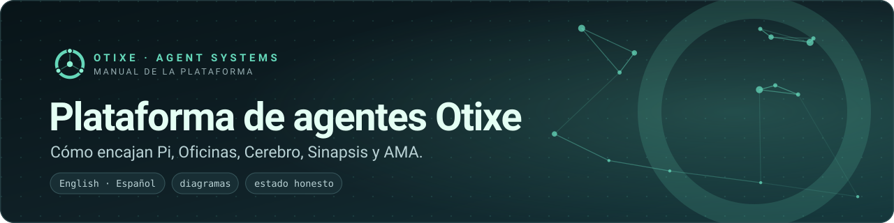
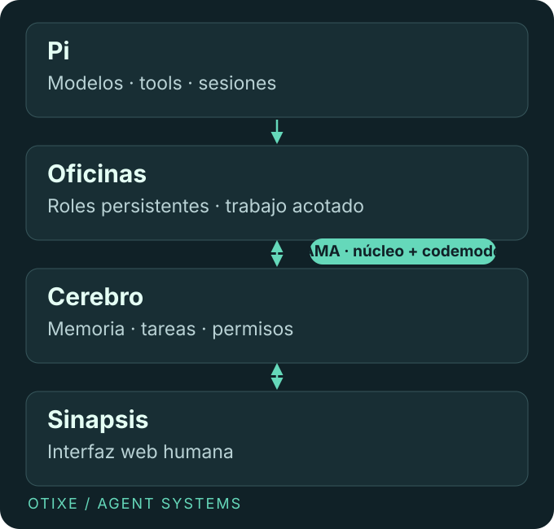

# Agentes persistentes. Memoria compartida. Control humano.

**Un equipo coordinado, no una colección de chats.** Pi ejecuta agentes. Oficinas les da roles persistentes. Cerebro conserva conocimiento y estado de trabajo compartidos. Sinapsis hace visible ese estado a las personas. AMA reduce la superficie de definiciones de tools entre el runtime y Cerebro.

## El problema

Un agente tiene una ventana de contexto finita. Las tareas largas acumulan explicaciones repetidas, decisiones perdidas y definiciones de tools costosas. Agregar agentes no resuelve eso por sí solo: sin responsables y revisión, duplican trabajo o aprueban sus propios errores.

## La solución

Separar **ejecución**, **estructura del equipo**, **estado compartido** y **control humano**. Dar a cada rol sólo los permisos necesarios, preservar decisiones fuera del contexto transitorio y exigir evidencia proporcional antes de aceptar un cambio.

| Capa | Qué aporta | Por dónde empezar |
| --- | --- | --- |
| Pi | Modelos, tools, sesiones, terminal y ciclo de extensiones. | [Runtime](pi.md) |
| Oficinas | Especialistas persistentes, delegación acotada y responsable de tarea. | [Equipos](oficinas.md) |
| Cerebro | Memoria, tareas, documentos, skills, correspondencia y permisos. | [Estado compartido](cerebro.md) |
| Sinapsis | Acceso web humano al mismo estado operativo. | [Interfaz web](sinapsis.md) |
| AMA | Perfiles directos pequeños y estables más acceso por codemode. | [Integración, diseño y regla de caché](ama.md) |

## Qué está disponible hoy

El [monorepo de extensiones](https://github.com/otixe/pi-oficinas) y seis paquetes npm `@otixe` en `0.1.0` son públicos. Pi tiene un [fork de Otixe](https://github.com/otixe/pi) y un [proyecto upstream](https://github.com/earendil-works/pi). El repo público de Cerebro y la publicación de Sinapsis están en preparación. Este manual es una entrega no publicada, no prueba de un servicio alojado activo.

Empezá por la [arquitectura](architecture.md) y un [quickstart de componente](pi.md). Para evaluar, leé el [método de trabajo](workflow.md) y el [capítulo AMA](ama.md) antes de asumir ahorros o conceder acceso.

!!! note "Alcance, no garantía"
    Se documenta un diseño operativo y extensiones publicadas: no se afirma certificación, SLA empresarial, ejecución totalmente autónoma ni ahorro universal. El [registro de fuentes](sources.md) separa hechos verificados, resultados reportados y publicaciones previstas.
