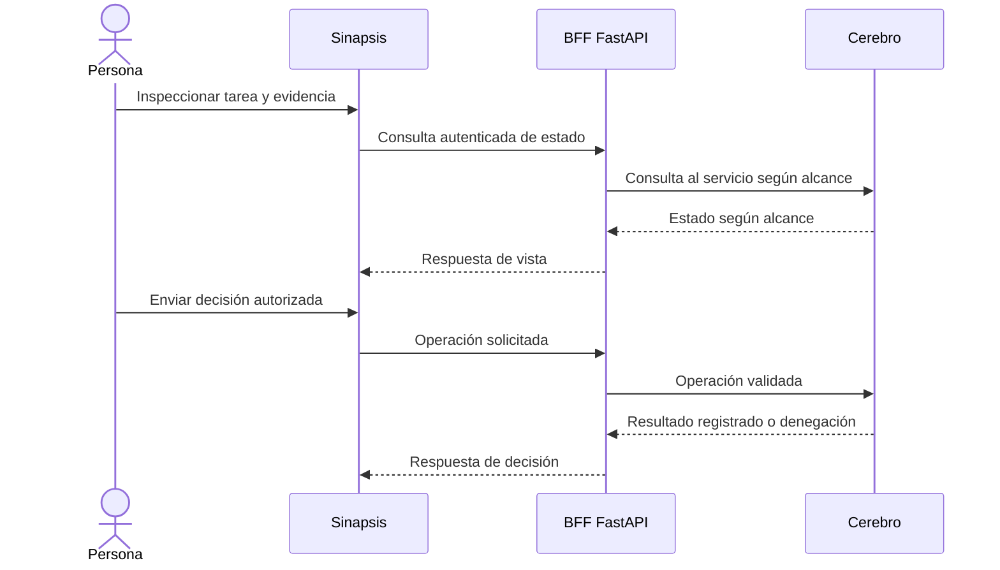

# Sinapsis · la superficie web humana

## Qué es / qué resuelve

Sinapsis es la interfaz humana sobre Cerebro: la contraparte web del acceso operativo desde terminal. Permite inspeccionar trabajo compartido, coordinar y decidir sin depender de la conversación actual de un agente ni de un pane abierto. **No** es otra memoria ni otra autoridad de autorización.

## Internos y tecnologías

El stack reportado es **React + Vite** para el frontend y un **BFF FastAPI (backend para frontend)** que actúa como cliente de Cerebro. Estos detalles provienen de documentación interna de diseño/runbook, no de un build público reproducido para este manual. El coordinador confirmó arquitectura y publicación en preparación. La UI presenta estado de Cerebro; sus acciones deben validarse en servicio y limitarse al actor autenticado.

Visibilidad de lectura y autoridad de decisión son distintas. Una pantalla puede mostrar una tarea sin permitir aprobarla. Un acuse de mensaje no es aprobación; una notificación de UI no es responsable duradero de tarea.

## Quickstart: checklist del operador

!!! warning "Fuente pública pendiente"
    No hay repo público ni comando de instalación reproducible de Sinapsis confirmado para esta entrega. Esto es integración conceptual y checklist de aceptación, no un tutorial ejecutable de `git clone`. Fuente pública y pasos de despliegue siguen siendo requisito para publicar.

En una instancia provisionada por su operador:

1. Iniciá sesión con tu identidad humana aprobada; nunca expongas keys de agente ni administrativas en bundles frontend.
2. Confirmá entorno seleccionado y rol antes de modificar algo.
3. Abrí una tarea reversible de prueba y contrastá su estado actual con la misma tarea recuperada de Cerebro desde Pi.
4. Probá una operación permitida, una denegación esperada y manejo de estado obsoleto. El backend debe rechazar acciones no autorizadas aunque se manipulen controles del cliente.
5. Inspeccioná evidencia, atribución de actor y decisión registrada después de refrescar.
6. Definí revocación de acceso, política HTTPS, retención de auditoría, backup/restauración y escaneo de secretos frontend antes del despliegue.

## Aceptación y límites

Este manual no afirma completitud de features UI, capturas de producto público ni despliegue Sinapsis probado independientemente. La secuencia describe el contrato de datos/control esperado. Consultá [fuentes y estado](sources.md) para distinguir reportado de verificado y el [método de trabajo](workflow.md) para gates de decisión.
