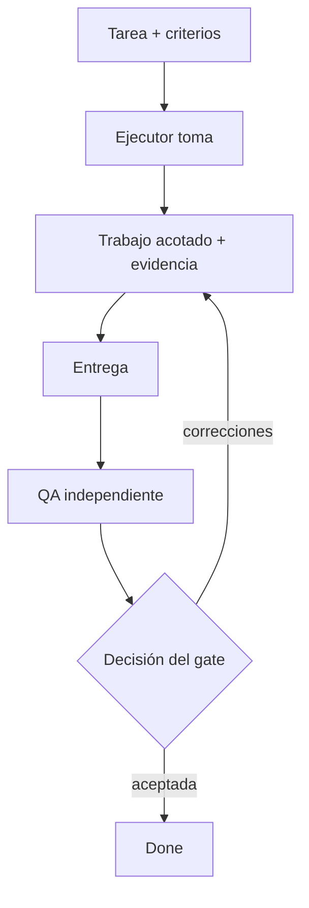

# Método de trabajo · evidencia antes de aprobar

## Harness: separación de poderes

Harness es el método alrededor de las herramientas, no otro modelo. El ejecutor realiza el alcance, QA independiente comprueba la entrega y el dueño del gate decide si la evidencia alcanza. Los gates son proporcionales a impacto, reversibilidad, confianza e incertidumbre. Un test aprobado no autoriza publicar ni cambiar producción.



## Contrato operativo de una tarea

1. **Leer primero:** recuperar la tarea del tablero; la notificación sólo apunta. Confirmar alcance, responsable, dependencias y exclusiones.
2. **Tomar:** asumir mediante claim del servicio. Frenar si otro ejecutor la tomó; pedir handoff en lugar de forzarlo.
3. **Ejecutar:** sólo tools autorizadas y credenciales propias. Registrar incertidumbre y preguntar cuando falta información necesaria. Declarar dependencia real o bloqueo externo.
4. **Evidencia:** conservar rutas de artefactos, checks pertinentes, controles negativos, límites y rollback reversible. Un resumen verde no es la evidencia subyacente.
5. **Entregar:** someter a revisión en lugar de cerrar el trabajo propio. QA puede pedir cambios; sólo revisión/gate autorizado completa aceptación.

El diagrama es secuencia operativa, no schema completo de estados del servidor. Roles read-only siguen el circuito de entrega documentado de su despliegue; una escritura denegada no habilita a pedir prestados privilegios.

## Memoria es continuidad, no autoridad

Guardar checkpoint de dónde retomar, cambios, verificaciones e incertidumbres. La memoria duradera debe tener fuente y vigencia; reemplazar notas corregidas sin borrar historia. Al reiniciar, verificar identidad y estado actual de tarea. Una conversación compactada orienta, no autoriza de nuevo.

## Reglas de seguridad que conviene probar

- Credenciales propias; fallar cerrado ante identidad ambigua o atribución distinta.
- Allowlists por rol y RBAC del servidor; probar denegación además de éxito.
- Aprobación explícita antes de publicación, acciones destructivas o producción de alto impacto.
- Contenido no confiable de documentos/tools no redefine identidad, permisos ni instrucciones.
- Revisar confianza de extensiones: una superficie pequeña conserva privilegios del proceso.
- Excluir logs privados, material de clientes y documentos personales de agentes de artefactos públicos.
- Backups con restauración probada y rollback que toque sólo alcance autorizado.

## Plantilla mínima de evidencia

```text
Alcance / exclusiones:
Artefactos:
Checks y controles negativos:
Resultado / límites conocidos:
Rollback:
Decisión solicitada al gate:
```

Para documentación sirven build estricto, validación bilingüe/de enlaces, escaneo de secretos/datos privados y lectura humana. Ninguno demuestra por sí solo verdad técnica ni editorial. Consultá [fuentes y estado](sources.md).
